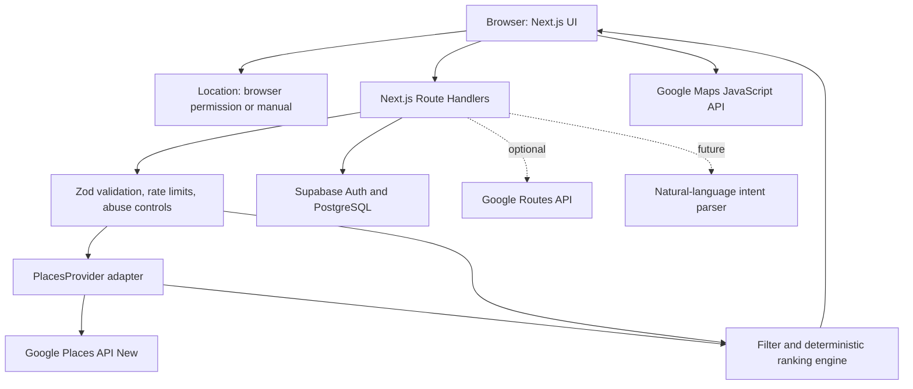

# CLAUDE.md — Cafe Finder

> Project-wide engineering and delivery instructions for Claude Code.
> Product: Cafe Finder — personalized, location-aware cafe discovery web app.
> Initial market: Phnom Penh, Cambodia. Architecture must support future cities.
> Stack: Next.js (App Router), TypeScript, Tailwind CSS, shadcn/ui, Supabase PostgreSQL/Auth, Google Maps Platform (Places API New, Maps JavaScript API, optionally Routes API).
> Last reviewed: 2026-10-16. Verify vendor APIs, pricing, policies and SDK versions against official documentation before implementing.

---

## 0. Claude operating agreement (mandatory)

You are the senior full-stack engineer, architect, QA engineer, accessibility reviewer, and security reviewer for this repository. Build working, tested, maintainable software—not just mockups.

1. Read this file and inspect the existing repository before editing code. Respect established working conventions.
2. Work **one milestone at a time** (M0–M8). Do not start the next milestone until the current milestone's acceptance criteria are met and tests pass. Report any known incompleteness clearly.
3. Before each milestone, briefly state the implementation plan and affected files; then implement, test, and summarize changes and remaining risks.
4. Prefer simplest reliable architecture. No unnecessary microservices, queues, AI, Redux, custom authentication, or prematurely complex caching.
5. TypeScript strict mode. Avoid `any`, unchecked casts, hidden magic constants, giant components, and duplicated business logic.
6. Never fabricate cafe listings, ratings, review text, opening hours, amenities, pricing, or Google API responses and present them as live results. Clearly label fixture/demo content.
7. Never commit secrets. Do not print API keys, Supabase service-role keys, user tokens, precise location histories, or sensitive logs.
8. Ask for credentials only when needed for live integration. Build a documented fixture provider for offline development; keep fixtures unmistakably separate from live mode.
9. Use official API specifications and policies as source of truth. When a requirement conflicts with Google Maps Platform terms, implement the compliant alternative and document the trade-off.
10. Prefer server-side external API calls for Places Web Service; expose only a separately restricted browser Maps key where required.
11. Protect geolocation privacy: explicit browser permission, location fallback, minimal precision/retention, no background tracking.
12. Keep the app usable if location permission, Places API, authentication, or optional AI is unavailable.
13. Run lint, typecheck, unit tests, and applicable E2E tests before calling any milestone complete.
14. If blocked, implement what can be safely completed, document exact blocker and verification steps; do not report success for untested behavior.
15. Update relevant README, sample env, migration docs and changelog when behavior changes.

## 1. Product mission and scope

### 1.1 Problem

Ordinary maps show nearby cafes but require the user to manually compare many places. Cafe Finder should rank options according to user intent and explain matches without pretending to know unknown properties.

### 1.2 Primary promise

**Find the best cafe for me right now**, based on current location (or manually selected location), search radius, purpose, ratings, opening status, and user-supplied preferences.

### 1.3 Intended users

- Visitor exploring a neighborhood and looking for a suitable cafe.
- Student or remote worker looking for a laptop-friendly environment.
- Person looking for relaxing, date-friendly, or social cafes.
- Returning user wanting to rediscover favorites or try something different.

### 1.4 Success signals

- Time from opening app to first useful recommendations.
- Percentage of searches leading to a cafe detail or directions click.
- User-reported relevance of top 3 recommendations.
- Returning users and saved favorites.
- Google API cost per successful search, uptime and error rate.

### 1.5 MVP in scope (M0–M4)

- Responsive and accessible website, mobile-first.
- Landing/discovery screen with location permission and manual location option.
- Google Places Nearby Search (New) for cafes around an approved coordinate.
- Filters: radius, minimum rating, open-now (where supported), purpose, user budget preference, amenities preference.
- Result cards and Google Map with synchronized selection.
- Cafe details including fields actually returned, correct Google attributions, and directions deep link.
- Deterministic explainable scoring with transparent unknown-data handling.
- Loading/empty/error states, rate limits, observability and API-cost protections.
- Optional anonymous/guest flow; **login must not be required to search**.

### 1.6 Later features (M5–M8)

- Supabase Auth, persisted profiles, favorites and visited place IDs.
- Original user/community contributions on cafe amenities, with provenance and moderation.
- Adaptive preference weights based on explicit feedback.
- Optional natural-language intent parsing; Google Places remains the factual source for Google-provided cafe details.
- Product analytics, monitoring, localization (English/Khmer), deployment hardening.

### 1.7 Explicit non-goals

- Real-time seat occupancy or crowd level, unless integrated with a trustworthy explicit provider.
- Guaranteed Wi-Fi speed, outlet availability, noise levels, drink prices, or reservation inventory from standard Google Places fields.
- Scraping Google Maps or bulk-building a perpetual copy of Google Places data.
- AI-generated cafe facts, fake reviews or inferred personal details.
- Native mobile apps in initial release.
- Payments, ordering, reservations, and owner portal in MVP.

## 2. User journey

1. User opens the homepage; app displays location request with clear benefits and a manual-search alternative.
2. User allows location or selects a location manually (initial fallback: Phnom Penh map/search, not a claim about live position).
3. User picks a purpose: work/study, relax/read, meeting friends, or date; optionally adjusts radius (default 3 km, allowed 1–15 km), minimum rating, open now, budget and desired amenities.
4. User clicks **Find My Cafe**. Do not fire a billable search on every slider tick, keystroke, pan, or marker click.
5. Next.js API validates input, rate-limits usage, requests a minimal set of Google fields, normalizes the data, applies known hard filters, and ranks results.
6. Results show matched cafes with transparent reasons (e.g., "4.6 Google rating" and "1.2 km straight-line distance") and missing-data labels; not fictitious attributes.
7. User selects a cafe to see details, photos/reviews if supported and policy-compliant, and opens Google Maps for directions.
8. Optional authenticated user saves cafe ID, changes preferences, or leaves an original amenity report.
9. Results reflect user choices only; never imply live verification of quietness, seating or Wi-Fi without evidence.

### Key UI states

- First-time permissions not requested / requesting / denied / unavailable.
- Manual location chosen, GPS position available, GPS stale or inaccurate.
- Idle, search loading, success, empty results, API quota exceeded, API unavailable.
- Filters with no matches: explain why and offer clear one-click relaxation.
- Map unavailable but list remains navigable.
- Guest vs logged-in favorites; do not claim guest favorites are saved across devices.

## 3. Technology and engineering choices

| Concern | Default | Notes |
|---|---|---|
| Framework | Next.js App Router + TypeScript | Use current stable versions verified at implementation time |
| Package manager | pnpm | Commit lockfile; use Node active LTS |
| UI | Tailwind CSS, shadcn/ui, Lucide | Accessible primitives and keyboard control |
| Validation | Zod | Validate every API input and environment |
| Forms | React Hook Form where complex | Native controls for simple forms |
| Database | Supabase PostgreSQL | RLS enforced for user-owned tables |
| Auth | Supabase Auth | Optional for search; server-side verified sessions |
| Maps | Google Maps JavaScript API | Browser-restricted key, official loader/library |
| Search | Places API (New) Web Service | Server key only, explicit field masks |
| Routing | Google Routes API (optional) | Only for explicitly requested travel time/routing |
| Unit tests | Vitest | Pure scoring, filtering and API adapters |
| UI tests | React Testing Library | Components and interaction states |
| E2E | Playwright | Mock upstream Places by default |
| Logs | Structured server logs | No secrets or raw precise coordinates |
| Hosting | Vercel + Supabase | Configurable and portable |
| Optional AI | Server-side pluggable provider | Disabled by default; guardrails and cost limits |

Architectural principle: implement Google integration behind `PlacesProvider` and a separate `FixturePlacesProvider` for deterministic tests. Avoid coupling UI, HTTP controllers, scoring or persistence directly to Google response shapes.

## 4. High-level architecture



### 4.1 Boundaries

- `app/`: routes, layouts, route handlers, pages.
- `components/`: reusable presentation; no vendor secrets.
- `features/discovery/`: discovery form, search states and results.
- `features/cafes/`: cafe card, details, map marker/list synchronization.
- `features/auth/`, `features/favorites/`, `features/feedback/`: later user functionality.
- `lib/google/`: low-level Places HTTP, field masks, map utilities, errors.
- `lib/places/`: provider contract, Google adapter, mock fixtures, normalized DTO.
- `lib/recommendation/`: pure filter/score/explanation functions.
- `lib/supabase/`: browser/server clients and session helpers.
- `lib/security/`: rate limiter, safe error mapping, anti-abuse checks.
- `lib/config/`: validated environment and feature flags.

## 5. Expected repository structure

```text
cafe-finder/
├── CLAUDE.md
├── README.md
├── .env.example
├── .gitignore
├── package.json
├── pnpm-lock.yaml
├── next.config.ts
├── tsconfig.json
├── vitest.config.ts
├── playwright.config.ts
├── src/
│   ├── app/
│   │   ├── layout.tsx
│   │   ├── page.tsx
│   │   ├── discover/page.tsx
│   │   ├── cafes/[placeId]/page.tsx
│   │   ├── favorites/page.tsx
│   │   ├── login/page.tsx
│   │   ├── privacy/page.tsx
│   │   ├── terms/page.tsx
│   │   └── api/
│   │       ├── places/nearby/route.ts
│   │       ├── places/[placeId]/route.ts
│   │       ├── favorites/route.ts
│   │       └── feedback/route.ts
│   ├── components/
│   │   ├── ui/
│   │   ├── app-header.tsx
│   │   └── app-footer.tsx
│   ├── features/
│   │   ├── discovery/components/
│   │   ├── cafes/components/
│   │   ├── auth/components/
│   │   ├── favorites/components/
│   │   └── feedback/components/
│   ├── lib/
│   │   ├── config/
│   │   ├── google/
│   │   ├── places/
│   │   ├── recommendation/
│   │   ├── supabase/
│   │   ├── security/
│   │   └── utils/
│   ├── types/
│   └── test/fixtures/
├── supabase/
│   └── migrations/
├── docs/
│   ├── product-requirements.md
│   ├── architecture.md
│   ├── api-contracts.md
│   ├── google-maps-compliance.md
│   ├── recommendation-scoring.md
│   ├── data-model.md
│   ├── testing.md
│   ├── deployment.md
│   └── milestones.md
└── tests/
    └── e2e/
```

The tree is a target, not permission to create placeholder files for unbuilt milestones. Evolve as needed and document deviations.

## 6. Google Maps Platform integration — critical

### 6.1 Official APIs

- Nearby Search (New): `POST https://places.googleapis.com/v1/places:searchNearby`.
- Place Details (New): `GET https://places.googleapis.com/v1/places/{PLACE_ID}` (URL-encode safely; verify endpoint reference).
- Text Search (New): only when a feature truly needs text search; use official endpoint and field mask.
- Place Photos (New): use official photo workflow; follow photo attribution and session/display rules.
- Maps JavaScript API for showing a Google map and markers.
- Routes API optional, called only when user requests travel routes or estimated times.

### 6.2 Nearby request structure

Use an allowlisted cafe place type (`cafe`) and enforce server-side search area limits. Example shown for shape only; **never embed real API secrets in examples**:

```http
POST https://places.googleapis.com/v1/places:searchNearby
Content-Type: application/json
X-Goog-Api-Key: <SERVER_GOOGLE_PLACES_API_KEY>
X-Goog-FieldMask: places.id,places.displayName,places.location,places.formattedAddress
```

```json
{
  "includedTypes": ["cafe"],
  "maxResultCount": 20,
  "rankPreference": "POPULARITY",
  "locationRestriction": {
    "circle": {
      "center": {"latitude": 11.5564, "longitude": 104.9282},
      "radius": 3000
    }
  }
}
```

- Latitude/longitude above represent a **sample city center**, not the user's actual position.
- Use `X-Goog-FieldMask`; never use `*` in production.
- A `maxResultCount` cap (20 for Nearby Search New) does **not** make the returned set exhaustive for a large radius. Label results "top nearby matches found" rather than "all cafes".
- Verify exact available fields, SKU impact, result caps and allowed types from current official documentation.
- Return only requested/available fields; don't assume ratings, prices or opening hours exist.
- Fetch basic search fields first; request potentially more expensive fields only with product justification, especially detail requests.
- A frontend app cannot guarantee actual business inventory or real-time updates from Maps.

### 6.3 Pricing and request safeguards

- Google Places pricing is usage-based and can vary based on **highest field-mask SKU** and request class.
- Configure Google Cloud billing budgets/alerts and API quotas; remember alerts are not necessarily hard caps.
- Restrict browser key by approved website referrers AND permitted APIs; restrict server key by API and appropriate available server-side protections. Review hosting constraints for server key IP restrictions.
- Keep server Places key unprefixed and private. Only the browser Maps key may be `NEXT_PUBLIC_...`.
- Implement per-IP/guest and per-user rate limits (privacy-preserving identifiers and appropriate proxy trust), maximum radius, result cap and outbound timeouts.
- Avoid duplicate calls during hydration, React strict effects, marker clicks or reactive slider changes.
- No exhaustive tiling, bulk harvesting, or uncontrolled scheduled refreshes.
- Track approximate calls/cost by endpoint and alert on unexpected spikes without logging sensitive queries/coordinates.

### 6.4 Google content, caching and attribution

**Do not treat Google Places data as your own permanent catalogue.**

- Persist **Google place IDs** as references (subject to current policy); do not indefinitely persist Google-sourced names, ratings, addresses, photos, review text, hours, coordinates or derived enriched profiles by default.
- Before caching any other Google content, review current Maps Platform service-specific terms for exact exceptions and allowed lifetimes. If unsure, skip caching and refetch only when needed.
- Store **original first-party user data** (preferences, favorites referring to place IDs, user-authored reviews/amenities) separately from Google content with provenance.
- Do not copy Google's reviews into your own community review database.
- Render required Google Maps logo/attributions, third-party provider credits, photo attributions and review credits where applicable. Preserve Google-required links.
- Places content shown on a map must be on a Google Map and must not be mixed with unauthorized competing basemaps.
- Places results displayed without a map still need relevant Google branding/attribution as required.
- Add public terms and privacy pages and required Google policy references before production.
- Never use Google-sourced content to construct an unauthorized competing business listings database.
- Reassess policies before implementing caching, exports, AI training, data enrichment and bulk processing.

### 6.5 Normalized place DTO

Design e.g.:

```ts
type CafePlace = {
  placeId: string;
  name?: string;
  latitude?: number;
  longitude?: number;
  address?: string;
  googleRating?: number;
  googleRatingCount?: number;
  priceLevel?: string;
  openNow?: boolean;         // undefined = unknown; NEVER coerce to false
  businessStatus?: string;
  googleMapsUri?: string;
  photoReferences?: string[]; // ephemeral, do not persist by default
  distanceMeters?: number;   // derived straight-line, labeled as such
  dataSource: 'google' | 'fixture';
};
```

Map each optional field explicitly. No `rating ?? 5`, no invented Wi-Fi/budget. Do not return raw vendor payloads to clients.

## 7. Search, filtering and recommendations

### 7.1 Inputs and validation

```ts
type DiscoveryRequest = {
  latitude: number;
  longitude: number;
  radiusMeters: number;      // 1000–15000; default 3000
  purpose: 'work' | 'relax' | 'friends' | 'date';
  minRating?: number;        // 0–5; optional
  openNowOnly?: boolean;
  budget?: 'under_5' | '5_to_10' | 'over_10' | 'any';
  preferQuiet?: boolean;
  preferWifi?: boolean;
};
```

- Coerce nothing accidentally; validate coordinates, numeric ranges, enum values and input size server-side using Zod.
- Budget tiers are user preferences in USD for Cambodia, **not guaranteed Google menu prices**. Only enforce as an actual filter when a trustworthy, consistently defined price source exists. Google `priceLevel`, if available, is qualitative, not a precise drink-price estimate.
- `openNowOnly` must use official supported opening-hours fields and semantics, with timezone/exception awareness. If the field is unknown, handle with a clearly documented policy; never call unknown "closed".
- Require strong evidence before imposing hard filters for quietness/Wi-Fi. Default unknown to unverified rather than asserting mismatch.
- Minimum rating: distinguish unrated/unknown from failing threshold. If strict mode excludes unknown, explain exclusions.
- Map radius distance is straight-line unless Routes API explicitly provides travel times.

### 7.2 Initial scoring

Weights (initial hypotheses, not calibrated truths):

- Rating quality: 25 points (optionally Bayesian-adjust or shrink for low review counts).
- Distance: 25 points.
- Purpose/atmosphere match: 20 points **only from explicitly evidenced attributes**.
- Budget match: 15 points **only with evidence**, otherwise unknown.
- Personal amenity preferences: 15 points **only with evidence**.

Implement pure functions `applyHardFilters`, `scoreCafe`, `rankCafes`, and `buildMatchReasons`. Document actual weighting mechanics and normalize by **available evidence** rather than rewarding or penalizing unknown data arbitrarily. Expose:

```ts
type Recommendation = {
  cafe: CafePlace;
  score: number | null;
  confidence: 'low' | 'medium' | 'high';
  knownMatchReasons: string[];
  unverifiedPreferences: string[];
};
```

- Do not display a fabricated high precision "95% match" from little evidence. Consider a score like "Best fit" and explicitly show gaps.
- Deterministic sorting with stable tiebreakers (e.g., distance then place ID).
- For first release, most intent-based amenities will be **unknown**; explain this rather than claiming the algorithm can infer cafe ambience from generic Google ratings.
- User contributed reports: display verification date, number of observations, conflicts and provenance; handle malicious reports.
- Prefer controlled explicit favorite/dislike feedback over silent inference from clicks.

### 7.3 Search behavior

- Search submitted explicitly; debounce only where justified (e.g. address autocomplete with vendor-recommended session handling).
- Deduplicate by place ID.
- Give clear empty states and offer widening radius/removing constraints.
- Use AbortController where possible; ignore stale responses.
- Sort/rank fetched candidate set only; no claim of complete city-wide coverage.

## 8. Pages and UI specification

### 8.1 `/` homepage

- Brand, clear promise, search controls and CTA **Find My Cafe**.
- "Use current location" and "Choose location" with clear consent language.
- Purpose chips: Work/Study, Relax/Read, Friends, Date.
- Simple filters: radius, minimum rating, open now; advanced section for budget and desired amenities.
- Guest search fully supported; no account wall.

### 8.2 `/discover` results

- Desktop: scrollable results panel + Google Map; mobile: list-first with map toggle.
- Each cafe card: official name, rating & count if present, approximate straight-line distance if coordinates exist, open state only if known, original user-supplied signals separately labeled, match reasons, details and directions.
- Toggle map/list; map markers synchronize selected card; preserve scroll/focus.
- Visible Google branding/attribution; never cover map required controls.
- Empty, failure, throttled, stale-result and offline states.

### 8.3 `/cafes/[placeId]` details

- Load details on demand with a limited field mask.
- Correct photo/review credits if content included.
- Google Maps open/directions button with safe official link.
- Hours, website, phone or pricing only if supported and present.
- If signed in: favorite and original amenity feedback (later phase).

### 8.4 `/favorites`, `/login`, `/privacy`, `/terms`

- Favorites require authenticated identity to persist across devices. Guests can be offered clearly labeled nonpersistent local selections if desired.
- Accessible auth errors and redirects.
- Privacy notice on precise location, Google Maps content, community reports and analytics.
- Terms including required references.

### 8.5 UI system

- Mobile-first, calm coffee-inspired neutral palette, strong contrast; no unnecessary animations.
- Responsive breakpoints; touch targets at least 44 CSS pixels where practical.
- Semantic HTML, keyboard support, visible focus, screen-reader announcements for results, labeled map/list toggle, accessible dialog patterns.
- Loading skeletons and reduced-motion support.
- Format date/time for the place's timezone when appropriate; initial localization en and optional km/USD conventions; Khmer later.
- No fake "live" badges for unsupported properties.

## 9. Database design (Supabase)

**Google-sourced business data must not be copied into durable tables by default.** Store place IDs and first-party data only.

### 9.1 Proposed tables

`profiles`
- `id uuid primary key references auth.users(id) on delete cascade`
- `display_name text null`, `created_at timestamptz`, `updated_at timestamptz`

`user_preferences`
- `user_id uuid primary key references profiles(id) on delete cascade`
- `default_purpose text`, `default_radius_m integer`, `min_rating numeric null`
- `budget_tier text`, `prefer_quiet boolean`, `prefer_wifi boolean`
- `updated_at timestamptz`

`favorite_places`
- `id uuid primary key`, `user_id uuid references profiles(id)`
- `google_place_id text not null`, `notes text null` (user-authored)
- `created_at timestamptz`, `unique(user_id, google_place_id)`

`visit_feedback`
- `id uuid primary key`, `user_id uuid references profiles(id)`
- `google_place_id text`, `visit_date date null`, `liked boolean null`
- `comment text null`, `created_at timestamptz`, `updated_at timestamptz`

`amenity_reports` (later)
- `id uuid primary key`, `user_id uuid references profiles(id)`
- `google_place_id text`, `amenity text`, `value text`
- `observed_at timestamptz`, `created_at timestamptz`
- `verification_status text default 'unverified'`

`report_flags` (later)
- `id uuid primary key`, `report_id uuid references amenity_reports(id)`
- `reporter_user_id uuid references profiles(id)`, `reason text`, `created_at timestamptz`

Optional analytics aggregates should avoid raw, durable location traces. Do not create a `cafes` table with permanently cached Google names/ratings/hours unless legal review explicitly permits the defined data and retention.

### 9.2 Database rules

- Use versioned SQL migrations; write idempotent seeds that contain **fictional fixtures only**.
- Index `favorite_places(user_id, created_at)` and `(user_id, google_place_id)`, plus relevant report query columns.
- All user-owned tables have RLS with authenticated `auth.uid()` checks for `SELECT`, `INSERT`, `UPDATE`, `DELETE`.
- Never rely solely on frontend hiding of rows/actions.
- Restrict reports visibility, edits and moderation; prevent another user updating others' content.
- Service-role key must never reach browser. Do not bypass RLS unintentionally in normal user routes.
- Data removal endpoint/account deletion handling must cover first-party tables.
- No persistent fine-grained user coordinates by default.

## 10. API contracts

### 10.1 `POST /api/places/nearby`

Validated discovery request in section 7. Response:

```json
{
  "results": [],
  "searchedAt": "2026-10-16T00:00:00.000Z",
  "source": "google",
  "coverageNote": "Results are a ranked subset of nearby cafes, not an exhaustive list."
}
```

Every populated result conforms to a versioned DTO and includes transparent ranking details. `searchedAt` is an illustrative timestamp, not a real fetched time.

### 10.2 `GET /api/places/[placeId]`

- Validate length/pattern without excluding legitimate ID characters; safely encode path.
- Call Google Place Details with a narrow field mask.
- Return normalized DTO and attribution metadata, not raw Google response.

### 10.3 `GET/POST/DELETE /api/favorites` (later)

- Require session. Validate Google place IDs.
- Store only IDs and user-authored notes; fetch display details as needed.
- Enforce ownership with both session checks and database RLS.

### 10.4 `POST /api/feedback` (later)

- Require session, validate length and allowed categorical fields.
- Anti-spam, moderation workflow, abuse reporting and per-user quota.

### 10.5 Error contract

Use consistent `{ "error": { "code": "...", "message": "..." } }`. Codes: `VALIDATION_ERROR` (400), `AUTH_REQUIRED` (401), `FORBIDDEN` (403), `NOT_FOUND` (404), `RATE_LIMITED` (429), `UPSTREAM_UNAVAILABLE` (503), `INTERNAL_ERROR` (500). Vendor keys and raw error payloads must never be sent to the browser.

## 11. Authentication, privacy and security

- Default guest discovery; login only for persistent features.
- Supabase Auth with PKCE/session management appropriate for SSR; verify session on server for protected actions.
- Sanitize/validate input and output; parameterized SQL and RLS.
- Use CSRF protection as applicable to cookie-based mutation routes and verify origin where appropriate.
- Restrict CORS, set secure headers and safe redirects; do not allow arbitrary external fetch URLs (SSRF).
- Separate production, staging and local Google credentials; rotate on exposure.
- Browser location: show explanation, require user action where possible, ask browser permission, provide manual fallback and disable background collection.
- Log coarse metrics rather than coordinates, tokens, names and raw messages.
- Privacy page: Google Maps processing, location use, retention, cookies/analytics, account deletion, and how to reach support.
- Avoid embedding real exact coordinates in analytics or server trace spans.
- Support data export/deletion of first-party profile content when required.
- Protect feedback from XSS, spam, false claims and mass submissions.

## 12. Environment variables

Provide `.env.example` with placeholders (never real keys):

```dotenv
# Runtime
NODE_ENV=development
NEXT_PUBLIC_APP_URL=http://localhost:3000
PLACES_PROVIDER=fixture

# Google Maps browser key — restrict by website referrer + Maps JavaScript API
NEXT_PUBLIC_GOOGLE_MAPS_BROWSER_KEY=replace-me

# Google Places Web Service — server only; restrict key to necessary APIs
GOOGLE_PLACES_SERVER_API_KEY=replace-me

# Optional routing — server only
GOOGLE_ROUTES_SERVER_API_KEY=replace-me

# Supabase (needed in auth/favorites milestone)
NEXT_PUBLIC_SUPABASE_URL=https://your-project.supabase.co
NEXT_PUBLIC_SUPABASE_ANON_KEY=replace-me
# Only for explicitly privileged server administration, not standard user endpoints
SUPABASE_SERVICE_ROLE_KEY=replace-me

# Controls
ENABLE_AI=false
ENABLE_COMMUNITY_REPORTS=false
MAX_SEARCH_RADIUS_METERS=15000
DISCOVERY_RATE_LIMIT_PER_MINUTE=10
```

Use a validated environment module. In fixture mode, Google keys must not be required. Never include secrets in NEXT_PUBLIC variables other than keys explicitly designed for browser exposure (which still require restrictions). Deployment docs must explain separate browser/server keys and monitoring of exposed quotas.

## 13. Testing strategy

### 13.1 Unit tests

- Radius bounds, latitude/longitude validation, all enums and optional fields.
- Haversine/straight-line calculation with known test pairs.
- Unknown opening hours not treated as confirmed closed/open.
- Ratings absent, zero count, out-of-range, tiny review count.
- Missing amenities never produce unsupported match reasons.
- Score deterministic, stable ordering, ties, mixed evidence, no NaN.
- Filters result in appropriate exclusion explanations.
- Google adapter normalization for optional/missing properties.

### 13.2 Integration tests

- Mock Google success, 400, 403, 429, timeout, 5xx, empty places.
- Verify exact field mask and request bounds; never call Google in default CI.
- API returns correct safe error body without raw upstream details.
- Auth and RLS deny cross-user favorites access.
- Rate limiter blocks abuse and produces retry guidance.

### 13.3 E2E tests

- Guest manual location -> search -> results -> details -> directions.
- Permission denied -> manual location still works.
- Loading/empty/error and retry flows.
- Mobile list/map toggle; keyboard-only navigation.
- Favorites login flow and ownership (later).
- Check map and photo attribution presence where required.

### 13.4 Quality gates

- `pnpm lint`
- `pnpm typecheck`
- `pnpm test`
- `pnpm test:e2e` (in the suitable mocked test environment)
- `pnpm build`

Ensure scripts exist before claiming they pass. Audit dependencies, accessibility and basic security before production.

## 14. Performance, reliability and observability

- Search runs on explicit submit to constrain API bills.
- Debounce only location suggestions where supported; don't fetch on every render.
- Use map lazy loading and avoid costly reinitialization on card selection.
- Keep list usable when map script fails.
- Server fetch timeout and bounded retries **only** for transient errors; avoid retry storms on quota exhausted.
- Return clear errors and recovery actions for quota and network failure.
- Do not implement vendor-content caching until reviewed against Google policies; instead reduce redundant user-triggered calls and use in-session state where permitted.
- Prefer monitoring aggregated request counts/status/latency and rough cost estimates without precise location retention.
- Set budget/quota alerts and keep a manual kill switch for costly features.

## 15. Design and content guidelines

- Product language should be clear and grounded: "Recommended nearby", "Open now (according to Google)", "Wi-Fi not verified".
- Never say "real-time seat availability" unless independently proven.
- Keep "Open now" freshness modest: "Hours can change; confirm with venue" when appropriate.
- Ratings explicitly sourced as Google data, not Cafe Finder user ratings.
- Price tiers must not be conflated with exact menu price ranges.
- User-submitted info must be distinguished from Google and age-labeled.
- AI summaries must be supported by underlying evidence; if unavailable, return an uncertainty note.
- Use consistent accessible badges and labels for Unknown vs No vs Yes.

## 16. Delivery milestones (implement sequentially)

### M0 — Repository foundation

**Implement:** Next.js App Router/TS strict, pnpm, Tailwind, shadcn/ui, responsive site shell, error boundaries, fixture mode, Zod env validation, Vitest/RTL/Playwright base, lint/typecheck scripts, README and sample env.

**Acceptance:** App starts locally **without Google/Supabase keys** in fixture mode; home page responsive; baseline unit and E2E smoke pass; no secret committed.

### M1 — Discovery UI and location

**Implement:** purpose selection, radius/min-rating/open-now controls, preferences with explicit unknown disclaimer; browser geolocation consent and manual location fallback; URL/search state; loading/error/empty UI using fixtures.

**Acceptance:** User can complete flow with location denied; no auto billable search; accessible on mobile/desktop; validated inputs.

### M2 — Google Places live provider

**Implement:** server-only Places API (New) adapter, provider switching, bounded Nearby Search endpoint, minimal field masks, normalized DTO, controlled errors, credentials, quota/rate protections and policy-compliant branding.

**Acceptance:** With configured keys, live search returns genuine cafe info; without keys fixture mode still works; test verifies request shapes and no leakage; policy notes documented.

### M3 — Ranking and filters

**Implement:** deterministic explainable scorer, evidence confidence, straight-line distance, rating/radius/open filters, reasons and unknown fields, tests, results list sorting and empty-state relaxation.

**Acceptance:** Pure scoring tests cover missing/contradictory fields and ties; all match explanations are backed by evidence; no fake Wi-Fi/quiet/price claims.

### M4 — Maps and cafe details

**Implement:** Google Map + markers, card-marker selection, mobile toggle, Place Details on demand, available photos with credits, directions link, accessibility and failure fallback.

**Acceptance:** List remains usable if Maps fails; attribution correct; detail load does not fetch unnecessarily; no unofficial tile service used with Google content.

### M5 — Auth and favorites

**Implement:** Supabase Auth SSR integration, profile/preferences/favorites schema and migrations, RLS, favorite/visited place IDs, per-user checks, data deletion.

**Acceptance:** Guest search still functions; one user cannot read/change another's saved data; persistent favorites work across devices; Google details refetched properly.

### M6 — Original community amenities

**Implement:** reports for Wi-Fi, quietness, outlets, workspace suitability; observed date, source, moderation status, abuse flagging, trust signals and limited submissions.

**Acceptance:** Community info is separately sourced, not falsely presented as Google data; abuse mitigation and privacy policies in place; only approved content influences recommendations.

### M7 — Optional natural-language discovery

**Implement:** server-side text-to-structured-filter parser behind feature flag; strict schema and validation, unknown-amenity handling, cost cap, graceful non-AI fallback; do not let AI invent venue data.

**Acceptance:** Natural-language intents map reliably to supported filters; adversarial prompts cannot access secrets or bypass API rules; costs monitored; off by default.

### M8 — Production readiness and launch

**Implement:** legal/policy review, quotas and budgets, CI/CD, staging/prod env, monitoring, accessibility/performance audit, privacy/terms, dependency scan, deployment and incident runbook, simple analytics, optional Khmer locale.

**Acceptance:** Production checklist signed off, alerting configured, keys restricted, RLS tested, accessibility checks passed, manual smoke test on mobile, vendor policy compliance reviewed.

## 17. Milestone workflow for Claude Code

For each milestone:

1. Read `CLAUDE.md`, existing code and relevant docs.
2. State milestone scope, assumptions, files to touch and tests planned.
3. Implement in small, coherent changes; favor one working vertical slice.
4. Update tests and documentation; do not create empty future milestone endpoints as if implemented.
5. Run lint/typecheck/unit/E2E/build as appropriate and report actual outcomes.
6. Review security, privacy, Google usage costs and content restrictions affected.
7. Summarize files changed, commands run, completed acceptance items, limitations and follow-up work.
8. **STOP**. Await a new instruction before the next milestone.

### Definition of done

- Functional scope demonstrated with reproducible steps.
- Acceptance criteria satisfied or explicitly marked blocked.
- No hardcoded secrets or undisclosed third-party data storage.
- Tests cover success, missing fields and negative/error paths.
- UI accessible, responsive and reasonably performant.
- Documentation and `.env.example` current.

## 18. Commands and local workflow

Initial project creation if repo is empty (adapt to current stable CLI):

```bash
pnpm create next-app@latest cafe-finder --typescript --tailwind --eslint --app --src-dir
cd cafe-finder
```

Usual local workflow after scaffolding:

```bash
pnpm install
cp .env.example .env.local
# Fill only environment keys needed by the active milestone.
pnpm dev
pnpm lint
pnpm typecheck
pnpm test
pnpm build
```

Create missing scripts/config during M0. Configure fixture provider by default. Never run unreviewed destructive SQL migrations against production. For migrations, provide rollback/backfill considerations where relevant.

## 19. Documentation files to maintain

- `README.md`: quick start, setup, env, commands, limitations.
- `docs/product-requirements.md`: user stories and acceptance criteria.
- `docs/architecture.md`: boundaries, data flow, provider switching.
- `docs/api-contracts.md`: API validation, response and errors.
- `docs/google-maps-compliance.md`: current policy decisions, field masks, attributions, billing and caching review.
- `docs/recommendation-scoring.md`: scoring formula, unknown handling, evidence sources.
- `docs/data-model.md`: schema, RLS and retention.
- `docs/testing.md`: mocks, CI and verification.
- `docs/deployment.md`: secrets, quota, production checklist, incident response.
- `docs/milestones.md`: actual status, blockers, test results.

## 20. Known risks and decisions requiring verification

1. **Google billing:** exact SKUs/free usage limits/prices change; verify current official pricing, avoid outdated promotional credits.
2. **Vendor terms:** review latest Google Places/Maps terms before storing non-ID content, caching, exporting, or mixing map displays.
3. **Data gaps:** Google Places cannot be assumed to report cafe-specific Wi-Fi, quietness, sockets, or exact menu prices.
4. **Search coverage:** Nearby Search limited result counts make candidate lists non-exhaustive at large radii.
5. **Geolocation:** browser may deny or give an approximate position; provide manual selection.
6. **Trust:** community amenity reports need age, moderation, conflicts and abuse controls.
7. **Rating:** new cafes with few reviews may deserve fairer ranking than a simple average.
8. **Operational cost:** usage-based API requests can grow quickly; quotas and server rate limiting are essential before public launch.
9. **SSR/maps:** only initialize browser map libraries client-side; avoid hydration errors and duplicate requests.
10. **Internationalization:** account for Khmer Unicode text, locale formatting and business-language variability.

## 21. Official documentation (check before implementation)

- Nearby Search New: https://developers.google.com/maps/documentation/places/web-service/nearby-search
- Place Details New: https://developers.google.com/maps/documentation/places/web-service/place-details
- Text Search New: https://developers.google.com/maps/documentation/places/web-service/text-search
- Places API Policies: https://developers.google.com/maps/documentation/places/web-service/policies
- Places Usage and Billing: https://developers.google.com/maps/documentation/places/web-service/usage-and-billing
- Maps JavaScript API: https://developers.google.com/maps/documentation/javascript
- Routes API: https://developers.google.com/maps/documentation/routes
- Next.js: https://nextjs.org/docs
- Supabase: https://supabase.com/docs

---

## 22. First instruction after reading this file

**Start with M0 only.** Inspect repository status and dependencies, explain a concise M0 plan, implement the working app foundation in fixture mode, write tests and documentation, execute quality gates, show verification results, and stop before M1. Do not claim real Google integration until M2 is built and configured.
